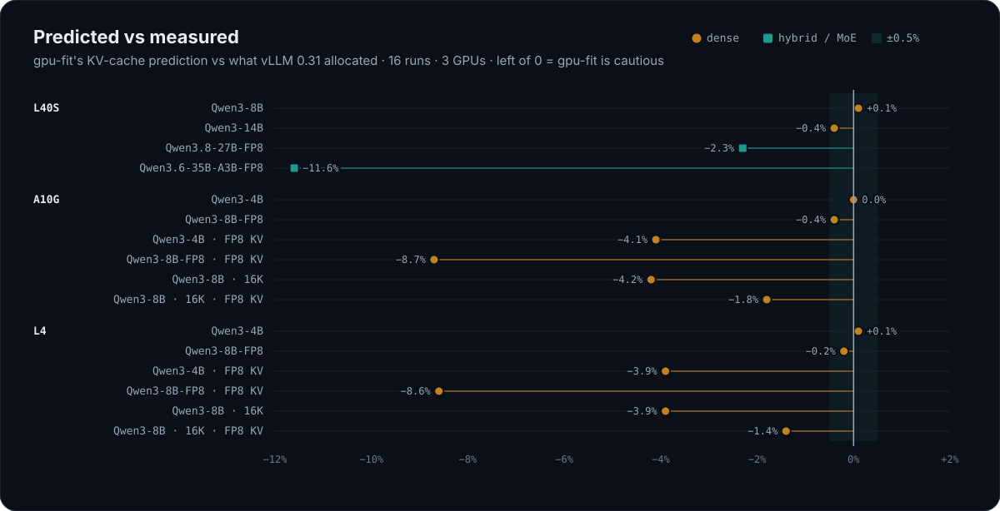

<a href="https://kirantallapragada.com">
<picture>
  <source media="(prefers-color-scheme: dark)" srcset="assets/hero-dark.svg">
  <source media="(prefers-color-scheme: light)" srcset="assets/hero-light.svg">
  
</picture>
</a>

### What I do

**Since 2024, CTO:** took AI products from one market to several, including a new international market, and built the 55+ engineering organisation (in-house and partner teams) behind them. **2018 – 2024, global pharma:** Manager to Lead Architect at Associate Director level.

<picture>
  <source media="(prefers-color-scheme: dark)" srcset="assets/cards-dark.svg">
  <source media="(prefers-color-scheme: light)" srcset="assets/cards-light.svg">
  
</picture>

### gpu-fit: will this model fit on this GPU?

Weights, runtime overhead and KV cache, the way vLLM actually allocates them, then a `vllm serve`
command that starts. [Repository](https://github.com/KiranTallapragada/gpu-fit) ·
[PyPI](https://pypi.org/project/gpu-fit/) · [browser calculator](https://kirantallapragada.com/gpu-fit/)

### Checked against real GPUs

<picture>
  <source media="(prefers-color-scheme: dark)" srcset="assets/accuracy-dark.svg">
  <source media="(prefers-color-scheme: light)" srcset="assets/accuracy-light.svg">
  
</picture>

Raw data and method: [gpu-fit/bench](https://github.com/KiranTallapragada/gpu-fit/tree/main/bench) · full table: [accuracy, measured](https://github.com/KiranTallapragada/gpu-fit#accuracy-measured)

### Building in the open

| Project | What it answers | |
|---|---|---|
| [**gpu-fit**](https://github.com/KiranTallapragada/gpu-fit) | Will this LLM fit on this GPU, how much context, how many users, and what if the GPU is shared? |  |
| [**gpu-guard**](https://github.com/KiranTallapragada/gpu-guard) *(new)* | Is your self-hosted LLM really on the GPU? A health check that catches silent CPU fallback, for vLLM, Ollama or any OpenAI-compatible server. |  |

### Stack

### Latest writing

<!-- BLOG-POST-LIST:START -->
- [What fits on a 24 GB GPU: measured on an A10G and an L4](https://kirantallapragada.com/2026/11/what-fits-on-a-24gb-gpu/)
- [A 32B model on a 48 GB GPU: what actually fits](https://kirantallapragada.com/2026/11/a-32b-model-on-a-48gb-gpu/)
<!-- BLOG-POST-LIST:END -->

Artwork is generated from measured data. Personal work: examples use public models and public data, with no employer or client names or confidential information. Views are my own.
